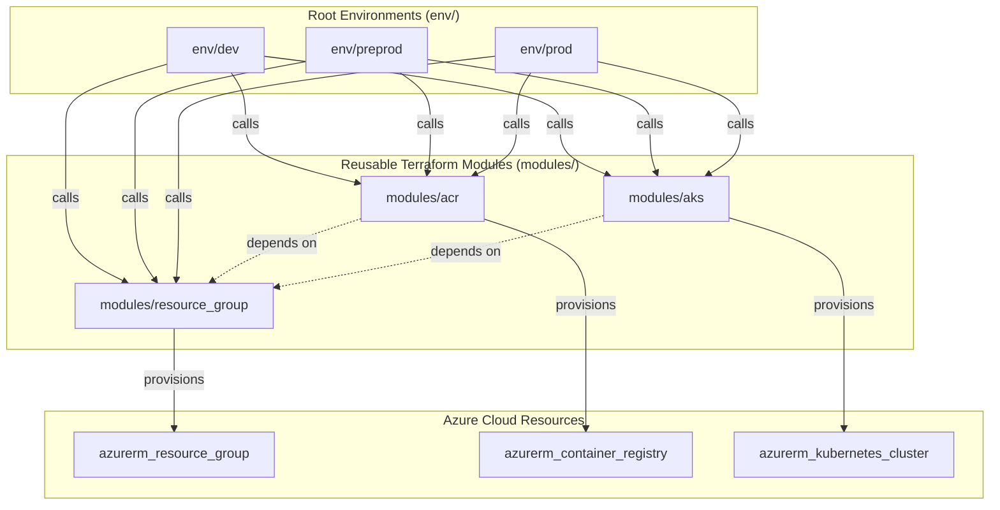

# 🚀 Azure AKS & ACR Multi-Environment Terraform Provisioning

[](https://azure.microsoft.com/)
[](https://www.terraform.io/)
[](https://kubernetes.io/)
[](LICENSE)

An enterprise-ready, modular Infrastructure as Code (IaC) repository built with **Terraform** for automated provisioning and lifecycle management of **Azure Kubernetes Service (AKS)**, **Azure Container Registry (ACR)**, and **Azure Resource Groups** across multiple isolated environments (**Dev**, **Preprod**, and **Prod**).

---

## 📋 Table of Contents

- [Overview](#-overview)
- [Architecture & Design](#-architecture--design)
- [Repository Structure](#-repository-structure)
- [Modules Breakdown](#-modules-breakdown)
- [Prerequisites](#-prerequisites)
- [Quick Start Guide](#-quick-start-guide)
- [Environment Configuration](#-environment-configuration)
- [Accessing the Cluster](#-accessing-the-cluster)
- [Teardown & Cleanup](#-teardown--cleanup)
- [Best Practices](#-best-practices)
- [Author](#-author)

---

## 🌟 Overview

This project provides reusable, modular Terraform components adhering to HashiCorp and Azure best practices:

- **Multi-Environment Architecture**: Dedicated configurations for `dev`, `preprod`, and `prod` preventing cross-environment drift and reducing blast radius.
- **Decoupled Modules**: Reusable modules for Resource Groups, Container Registry (ACR), and Kubernetes Clusters (AKS).
- **Dynamic Configuration**: Supports dynamic node pools, system-assigned managed identities, and parameterized resource tagging.
- **Explicit Dependency Management**: Coordinated module execution ensuring Resource Groups are established before provisioning dependent services.

---

## 🏛️ Architecture & Design



---

## 📂 Repository Structure

```text
azure-aks-terraform-provisioning/
├── .gitignore                      # Git ignore patterns
├── README.md                       # Repository documentation
├── env/                            # Root environment callers
│   ├── dev/                        # Development Environment
│   │   ├── main.tf                 # Module orchestrator for Dev
│   │   ├── variable.tf             # Input variables declaration
│   │   ├── terraform.tfvars        # Dev configuration values
│   │   ├── provider.tf             # AzureRM provider configuration
│   │   └── output.tf               # Environment outputs
│   ├── preprod/                    # Pre-production / Staging Environment
│   │   ├── main.tf                 # Module orchestrator for Preprod
│   │   ├── variable.tf             # Input variables declaration
│   │   ├── terraform.tfvars        # Preprod configuration values
│   │   ├── provider.tf             # AzureRM provider configuration
│   │   └── output.tf               # Environment outputs
│   └── prod/                       # Production Environment
│       ├── main.tf                 # Module orchestrator for Prod
│       ├── variable.tf             # Input variables declaration
│       ├── terraform.tfvars        # Prod configuration values
│       ├── provider.tf             # AzureRM provider configuration
│       └── output.tf               # Environment outputs
└── modules/                        # Reusable Child Modules
    ├── acr/                        # Azure Container Registry Module
    │   ├── main.tf                 # azurerm_container_registry resource
    │   └── variable.tf             # ACR input variables
    ├── aks/                        # Azure Kubernetes Service Module
    │   ├── main.tf                 # azurerm_kubernetes_cluster resource
    │   ├── variable.tf             # AKS input variables
    │   └── output.tf               # Cluster outputs (kube_config)
    └── resource_group/             # Azure Resource Group Module
        ├── main.tf                 # azurerm_resource_group resource
        └── variable.tf             # Resource group input variables
```

---

## 🧩 Modules Breakdown

| Module | Path | Description | Key Inputs |
| :--- | :--- | :--- | :--- |
| **Resource Group** | [`modules/resource_group`](modules/resource_group/) | Provisions Azure Resource Groups with customizable names, locations, and tags using `for_each`. | `rgs` (map of objects: name, location, tags) |
| **ACR** | [`modules/acr`](modules/acr/) | Provisions Azure Container Registry instances for hosting container images. | `acr` (object: name, location, resource_group_name, sku) |
| **AKS** | [`modules/aks`](modules/aks/) | Provisions Azure Kubernetes Service cluster with dynamic default node pool and system-assigned identity. | `aks` (object: name, location, resource_group_name, dns_prefix, default_node_pool, identity) |

---

## ⚙️ Prerequisites

Before you begin, ensure you have installed and configured the following tools:

1. **[Terraform](https://developer.hashicorp.com/terraform/downloads)** (v1.3.0 or higher recommended, tested on v1.9+)
2. **[Azure CLI](https://learn.microsoft.com/en-us/cli/azure/install-azure-cli)** (v2.40.0+)
3. **[kubectl](https://kubernetes.io/docs/tasks/tools/)** for Kubernetes cluster administration
4. An active **Azure Subscription** with permissions to create Resource Groups, AKS Clusters, and ACR instances.

Authenticate with your Azure account:

```bash
# Log in to Azure
az login

# Set your target subscription
az account set --subscription "<YOUR_SUBSCRIPTION_ID_OR_NAME>"

# Verify the active subscription
az account show --output table
```

---

## 🚀 Quick Start Guide

Deploy any environment (`dev`, `preprod`, or `prod`) by navigating into its directory and running the Terraform lifecycle commands:

### 1. Select and Navigate to Environment

```bash
# For Development:
cd env/dev

# Or for Pre-production:
# cd env/preprod

# Or for Production:
# cd env/prod
```

### 2. Initialize Terraform

Download the required `azurerm` provider and initialize module references:

```bash
terraform init
```

### 3. Review Execution Plan

Inspect the resources that Terraform will provision:

```bash
terraform plan
```

### 4. Deploy Infrastructure

Apply the configuration to provision resources in Azure:

```bash
terraform apply
# Enter 'yes' when prompted, or run:
# terraform apply -auto-approve
```

---

## 🔧 Environment Configuration

Each environment defines its own configuration in its respective `terraform.tfvars` file:

### Example `terraform.tfvars` (`env/dev/terraform.tfvars`)

```hcl
rgs = {
  rg1 = {
    name     = "rg-axion-dev"
    location = "eastus"
    tags = {
      environment = "dev"
    }
  }
}

acr = {
  acr1 = {
    name                = "acraxiondev"
    location            = "eastus"
    resource_group_name = "rg-axion-dev"
    sku                 = "Standard"
  }
}

aks = {
  aks1 = {
    name                = "aks-axion-dev"
    location            = "eastus"
    resource_group_name = "rg-axion-dev"
    dns_prefix          = "axion-dev"
    default_node_pool = {
      pool1 = {
        name       = "default"
        node_count = 2
        vm_size    = "Standard_D2s_v3"
      }
    }
    identity = {
      id1 = {
        type = "SystemAssigned"
      }
    }
  }
}
```

---

## ☸️ Accessing the Cluster

Once the Terraform deployment finishes successfully, obtain credentials and interact with your AKS cluster:

```bash
# 1. Fetch AKS credentials to configure kubectl context
az aks get-credentials \
  --resource-group rg-axion-dev \
  --name aks-axion-dev \
  --overwrite-existing

# 2. Verify cluster node connectivity
kubectl get nodes -o wide

# 3. Check cluster health and running system pods
kubectl get pods -A
```

---

## 🧹 Teardown & Cleanup

To avoid unnecessary Azure cloud costs, tear down deployed resources when no longer needed:

```bash
# Ensure you are in the target environment directory (e.g., env/dev)
cd env/dev

# Preview destruction plan
terraform plan -destroy

# Destroy resources
terraform destroy -auto-approve
```

---

## 🛡️ Best Practices & Security

- **Managed Identity**: AKS clusters use Azure **SystemAssigned** Managed Identities, eliminating static service principal secrets.
- **Environment Isolation**: Separate state boundaries across `dev`, `preprod`, and `prod` ensure production safety and independent rollouts.
- **Resource Tagging**: Resource groups and infrastructure include standard tags for billing attribution and environment identification.
- **Dynamic Blocks**: Modular configuration allows easy scaling of node counts and pool sizes per environment requirements.

---

## 👩‍💻 Author

**Priya Jaiswal**  
- GitHub: [@Pjaisw1103](https://github.com/Pjaisw1103)  
- Repository: [azure-aks-terraform-provisioning](https://github.com/Pjaisw1103/azure-aks-terraform-provisioning)
